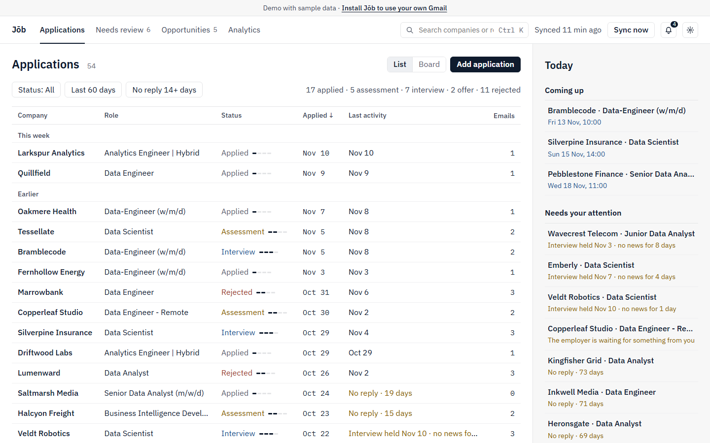
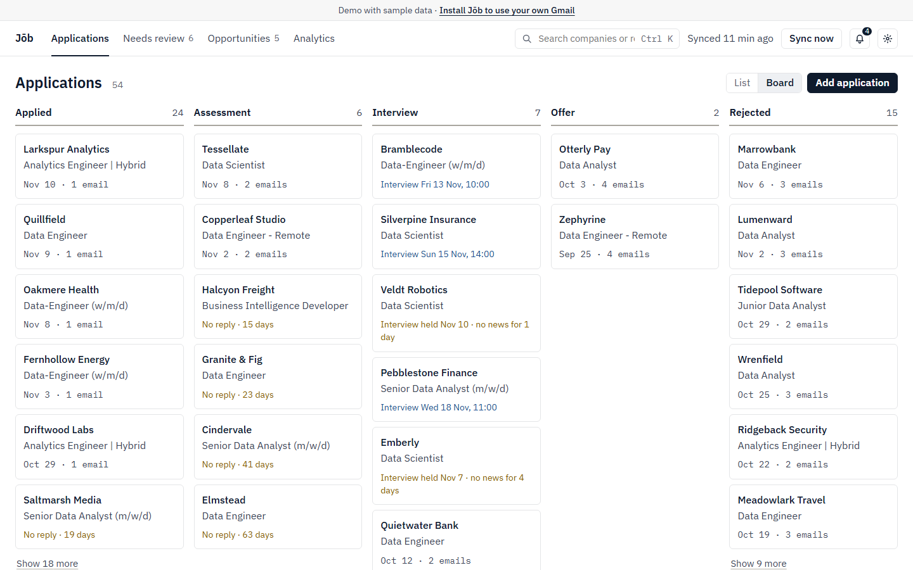
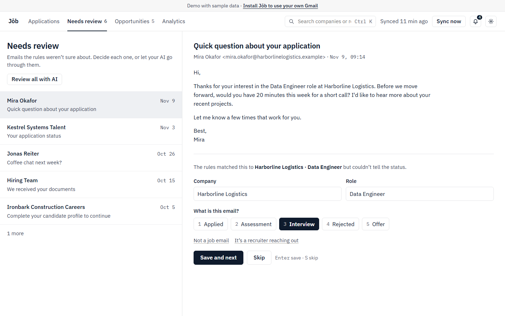
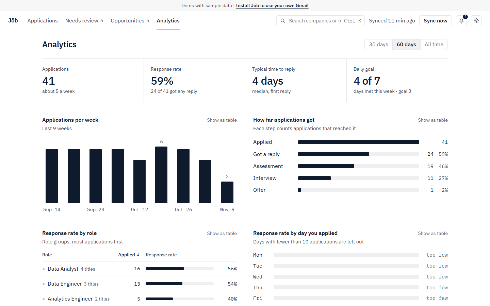

# Jōb

> **Early work in progress.** Expect rough edges and changes
> between versions.

Jōb is a self-hosted job search companion. It reads your Gmail, finds the emails about your job
applications and keeps track of them: who you applied to, for which role, and how far each one got.
It works without AI. If you want, you can add AI with your own provider or a local model. It runs on
your own computer.



**[Try the demo](https://jobcompanion.site/demo)** with made-up data in your browser. Nothing to install.

## Quick start

You need [Docker](https://docs.docker.com/get-docker/) (Docker Desktop on Windows and macOS).

In an empty folder:

```sh
curl -o docker-compose.yml https://raw.githubusercontent.com/youssefamr74/job-public/main/docker-compose.release.yml
docker compose up -d
```

Open <http://localhost:8000>. The setup wizard guides you through connecting your mail and, if you
want, an AI provider.

- Your data is kept in the `data` folder next to `docker-compose.yml`.
- Jōb is published on `127.0.0.1` only. It has no login, so do not expose it to a network.
- `TZ` sets your time zone, which decides what counts as "today" for goals and streaks. The default
  is `Europe/Berlin`. Set it in a `.env` file next to `docker-compose.yml`, for example
  `TZ=America/New_York`.

To update, run `docker compose pull` and `docker compose up -d`. Database migrations run when the
container starts. To back up, stop the container and copy the `data` folder. It holds the database
and the key that encrypts your saved credentials; keep them together.

## Connect Gmail

Follow [docs/setup-gmail.md](docs/setup-gmail.md). You can connect with Google OAuth or with IMAP and
an app password. With OAuth, add the redirect URI that Jōb shows you
(`http://localhost:8000/mail/oauth/callback` by default) in Google Cloud.

## Connect AI (optional)

Follow [docs/setup-ai.md](docs/setup-ai.md). Jōb supports Anthropic, OpenAI, Gemini, OpenRouter and
Ollama. To use Ollama on the same computer from Docker, set the base URL to
`http://host.docker.internal:11434/v1`. On Linux, Ollama must listen on more than localhost for this
(`OLLAMA_HOST=0.0.0.0`); keep your firewall closed to other machines.

## Privacy

- Your emails, applications and database stay on your computer, in the `data` folder.
- Jōb reads your mail only to find job applications. It never sends mail.
- Without AI, nothing is sent anywhere except to Gmail itself, to read your mail.
- With AI, only the emails the rules could not settle are sent to the provider you chose. You pick
  how much: subject and sender only (the default), or also the start of the body.
- If you use them, the weekly review, chat, CV features and "Suggest groups" send your statistics,
  messages, CV or role titles to the same provider.
- With a local model (Ollama), nothing leaves your computer at all.
- Your API key and mail credentials are stored encrypted in `data`.
- Nothing else leaves your computer. There is no account, no analytics and no tracking.

## Features

- Reads your mail through Google OAuth or IMAP, on demand and on a schedule, with progress and cancel.
- Finds application emails and sets the status: Applied, Assessment, Interview, Offer, Rejected.
- Sends emails it is unsure about to Needs Review instead of guessing. You decide, or let your AI go
  through them.
- Applications as a list or a board, with a Today panel: upcoming interviews and what needs your
  attention.
- Keeps recruiter outreach as opportunities, which you can turn into applications.
- Analytics: applications per week, how far they got, and response rates by role and by weekday.
  Roles are grouped by job title for any profession, and you can merge groups.
- Notifications for new replies, upcoming interviews and applications without an answer.
- Daily goals and streaks, and an optional weekly review written by your AI.
- A list of the emails that were skipped and why, so you can check what was missed.







## Known limitations

- The rules understand English and Polish emails so far.
- Small local models are less accurate than hosted ones.
- Gmail only for now. The IMAP design allows other providers later.
- See [docs/known-issues.md](docs/known-issues.md). Planned work is in [docs/roadmap.md](docs/roadmap.md).

## Run from source

The backend is tested with Python 3.13. From the `backend` folder:

```sh
python -m venv .venv
source .venv/bin/activate        # Windows: .venv\Scripts\Activate.ps1
pip install -r requirements-dev.txt
alembic upgrade head             # creates data/job.db at the repo root
python main.py                   # http://127.0.0.1:8000, API docs at /docs
pytest
```

No configuration is needed to start. To change a setting, copy `backend/.env.example` to `backend/.env`.

The web app is in `web` and needs Node 20. Keep the backend running, then:

```sh
cd web
npm install
npm run dev                      # http://localhost:5173, API calls go to the backend on port 8000
npm test
npm run lint
npm run typecheck
```

`npm run build` writes `web/dist`. When that folder exists, the backend serves the web app at
<http://127.0.0.1:8000> too.

To build the Docker image yourself instead of using the published one:

```sh
cp .env.example .env
docker compose up -d --build
```

The demo is the same web app with made-up sample data, answered in the browser by
[MSW](https://mswjs.io/); no backend is needed. `npm run dev:demo` runs it at
<http://localhost:5173/demo/>, and `npm run build:site` puts the landing page (`site/`) and the demo
together in `_site`. The normal build never contains the demo: `npm run check:build` checks `web/dist`.

The API types in `web/src/api/schema.ts` are generated from the backend. After changing the API,
run `python export_openapi.py` in `backend`, then `npm run gen:api` in `web`.

Releases are described in [docs/release.md](docs/release.md).

## Architecture

- FastAPI backend with SQLite (SQLAlchemy and Alembic).
- React web app (Vite, TypeScript, TanStack Query and Table, Radix UI). FastAPI serves the built app,
  so everything runs on one port.
- Mail sources behind one interface: Gmail API and IMAP.
- A rules classifier finds company, role and status. An optional AI layer fills the gaps, with
  single requests or batches.
- Sync runs are stored in the database, with stages, progress, cancel and a scheduler.

## Contributing

See [CONTRIBUTING.md](CONTRIBUTING.md).

## Security

To report a security problem, see [SECURITY.md](SECURITY.md).

## License

[MIT](LICENSE)
